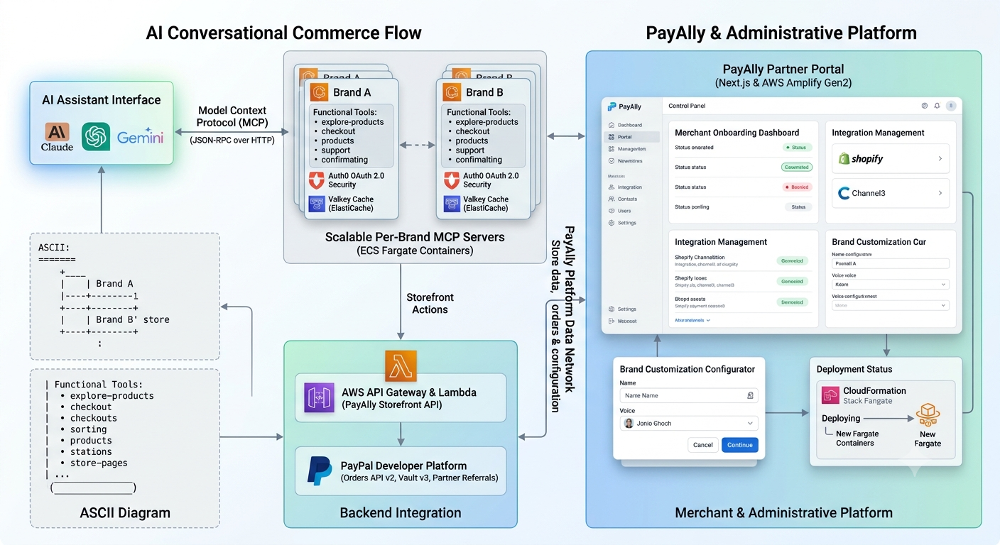

# PayAlly — Agentic Commerce for the 99%

> Give any brand its own AI storefront — customers browse, search, and purchase products inside ChatGPT, Claude, and Gemini, under the brand's identity, with real PayPal checkout. Deployed in 10 minutes. 2% per sale. Zero upfront cost.

[](https://opensource.org/licenses/MIT)

## Demo

- **Live site:** [payally.world](https://payally.world)
- **Functional Demo**[Youtube - PayAlly Demo](https://www.youtube.com/watch?v=nJb8kaD5mE8)
- **Story video:** [YouTube — PayAlly Story](https://www.youtube.com/watch?v=zlLB2LUXJc8)
- **Devpost:** [payally-partners](https://devpost.com/software/payally-partners)

---

## How It Works

1. **Merchant signs up** at [payally.world/signup](https://payally.world/signup) and connects their Shopify or Channel3 store
2. **PayAlly deploys** a dedicated, white-labeled MCP (Model Context Protocol) server on AWS ECS Fargate in ~10 minutes
3. **Customers chat** with any MCP-compatible AI assistant (Claude, ChatGPT, Gemini) and ask for products
4. **The AI assistant** calls the brand's MCP tools — `explore-product`, `getproductbyid`, `cart-add-items`, `checkout` — all under the brand's name
5. **Checkout completes** via PayPal inside the chat — no redirect, fully white-labeled

---

## Architecture



### How the flow works

1. A **merchant** signs up at the Partner Portal and connects their Shopify or Channel3 store
2. **One-click deploy** provisions a branded MCP server on AWS ECS Fargate via CloudFormation
3. A **customer** asks any MCP-compatible AI assistant for a product (e.g., Claude, ChatGPT, Gemini)
4. The AI assistant calls the brand's MCP tools — `explore-product`, `getproductbyid`, `cart-add-items`, `checkout`
5. Checkout completes via the **PayPal Orders API** — server-side, no prices exposed to the model
6. The entire flow is **100% white-labeled** — the customer sees only the brand, never PayAlly

## Repository Structure

This is the umbrella repository. The two application components are included as git submodules:

| Submodule | Repo | Purpose |
|---|---|---|
| [`payally-partner/`](https://github.com/varshney-ansh/payally-partner) | Partner portal | AWS Amplify Gen2 + Next.js merchant dashboard. Merchants onboard, connect their store, configure brand identity, and one-click deploy their branded MCP storefront. |
| [`mcp-app/`](https://github.com/varshney-ansh/payally-mcp-app) | Per-brand MCP server | The agentic-commerce MCP server deployed once per merchant. Exposes product discovery, cart, PayPal checkout, and order history as MCP tools + inline UI widgets. |

Additional directories:

```
payally/
├── mcp-app/                  # Submodule: per-brand MCP server
│   └── infra/                # CloudFormation template for per-brand ECS deployment
├── payally-partner/          # Submodule: partner portal dashboard
├── brand-identity/          # PayAlly logo assets (SVG + PNG)
├── screenshots/              # Demo screenshots for Devpost submission
├── docs/                     # Project documentation
│   └── final/                # Hackathon submission documents
├── LICENSE                   # MIT License
└── README.md                 # This file
```

## Tech Stack

| Layer | Technology |
|---|---|
| **Partner Portal** | Next.js 15, AWS Amplify Gen2, Cloudscape Design System |
| **MCP Server** | TypeScript, Express, @modelcontextprotocol/server + @modelcontextprotocol/node |
| **Authentication** | Auth0 (OAuth 2.0 resource server, AI Agents add-on) |
| **Payments** | PayPal Orders API v2, Vault API v3, Partner Referrals v2 |
| **Infrastructure** | AWS ECS Fargate, ALB, ElastiCache (Valkey), API Gateway, Lambda, CloudFormation, Route 53, ACM |
| **Caching** | Valkey (ElastiCache) for cart state |
| **Store Integration** | Channel3 SDK (demo), Shopify (production) |
| **Hosting** | AWS (ECS Fargate for MCP servers, Amplify Hosting for portal) |

## Prerequisites

- **Node.js** >= 20.0.0
- **npm** >= 10.0.0
- **Git** with submodule support
- **AWS account** with Amplify Gen2 CLI (`npx @aws-amplify/cli`)
- **Auth0** tenant with AI Agents add-on
- **PayPal** developer account (sandbox at [developer.paypal.com](https://developer.paypal.com/))

## Clone with Submodules

```bash
git clone --recurse-submodules https://github.com/varshney-ansh/payally.git

# or, after a plain clone:
git submodule update --init --recursive
```

To update submodules to their latest commits:

```bash
git -C mcp-app pull origin master
git -C payally-partner pull origin master
git add mcp-app payally-partner && git commit -m "Bump submodules"
```

## Setup & Installation

### 1. MCP Server (`mcp-app/`)

The per-brand MCP server that exposes product discovery, cart, and checkout as MCP tools.

```bash
cd mcp-app

# Install dependencies
npm install

# Copy the environment template
cp .env.example .env
# Fill in AUTH0_DOMAIN, AUTH0_AUDIENCE, AUTH0_MGMT_CLIENT_ID, AUTH0_MGMT_CLIENT_SECRET,
# BRAND_NAME, BRAND_STORE_NOUN, BRAND_PRODUCT_NOUNS, PAYALLY-X-APIKEY, PAYPAL_MERCHANT_ID, etc.

# Build the inline UI widgets (React components rendered as MCP tool results)
npm run build:ui

# Start the MCP server in development mode
npm start
```

The server listens on `http://localhost:3001/mcp` and exposes a health check at `/health`.

### 2. Partner Portal (`payally-partner/`)

The merchant dashboard for onboarding, store connection, brand configuration, and one-click deploy.

```bash
cd payally-partner

# Install dependencies
npm install

# Initialize Amplify Gen2 backend (first time only)
npx ampx generate outputs --branch main

# Build the custom Cloudscape theme
npx tsx cloudscape-custom-theme-build.ts

# Start the development server
npm run dev
```

The portal runs on `http://localhost:3000`.

### 3. Per-Brand CloudFormation Deployment

The `mcp-app/infra/brand-mcp-template.json` is the CloudFormation template used by the deploy-brand Lambda to provision per-brand infrastructure:

- ECS Fargate task definition (branded container)
- Application Load Balancer listener rule (host-header routing to `<brand>.mcp.payally.world`)
- ElastiCache (Valkey) cluster for cart state
- ACM TLS certificate + Route 53 DNS record
- IAM task role with ElastiCache connect permissions

## PayPal Integration

PayAlly integrates three PayPal developer platform modules:

### Module 1: PayPal Checkout
- **PayPal Orders API v2** — creates checkout orders from cart items mapped to PayPal's `item` schema
- **PayPal Merchant ID** — per-brand, stored server-side, never exposed to the AI agent or customer
- Prices and product details are built from server-side cached catalog data — the AI model can choose *what* to add to the cart, but cannot alter pricing or item details

### Module 2: PayPal Customer Vault (Advanced Vaulting)
- **Vault Setup Tokens API** (`/v3/vault/setup-tokens`) — initiates the vaulting flow during customer login
- **Payment Tokens API** (`/v3/vault/payment-tokens`) — creates a vaulted payment token for repeat one-click checkout
- Uses `PAYPAL_WALLET_VAULTING_ADVANCED` capability with `VAULT` and `BILLING_AGREEMENT` usage types

### Module 3: PayPal Merchant Onboarding (Partner Flow)
- **Partner Referrals API** (`/v2/customer/partner-referrals`) — generates onboarding links for new merchants
- **Platform Access Token** — cached for 8 hours, used for partner-level API calls
- **Partner Attribution** — `PayPal-Partner-Attribution-Id` header on all PayPal API calls
- Merchants are enabled for `EXPRESS_CHECKOUT` + `ADVANCED_VAULTING` products

## AI Integration

| Tool | Role |
|---|---|
| **MCP (Model Context Protocol)** | Open protocol for AI-assistant interoperability. Every brand deploys a dedicated MCP server — any MCP-compatible assistant can discover and use the brand's store. Build once, be discoverable everywhere. |
| **@modelcontextprotocol/server** | SDK that registers the brand's tools (`explore-product`, `getproductbyid`, `cart-add-items`, `cart-update-items`, `cart-remove-items`, `cart-discard`, `checkout`, `list-my-orders`, `get-order-details`) and handles JSON-RPC transport |
| **@modelcontextprotocol/node** | `NodeStreamableHTTPServerTransport` exposes the MCP server over HTTP POST |
| **Auth0 AI Agents** | OAuth 2.0 resource server flow validates bearer tokens from AI agents, extracts buyer identity (`sub`), resolves email via the Auth0 Management API |

## Testing Instructions for Judges

### How to Test

1. **Log in** to the [PayAlly Partner Portal](https://payally.world) using the demo merchant credentials above

2. **Connect the merchant's MCP endpoint** in any MCP-compatible AI assistant:
   - **Claude:** Use the MCP configuration to connect to the merchant's branded MCP endpoint
   - **ChatGPT:** Configure the merchant's MCP server as a custom GPT connector
   - **Gemini:** Connect via MCP in Google AI Studio

3. **As a customer**, use any PayPal sandbox account to:
   - Ask the AI assistant for a product (e.g., "find me a silk saree for a party")
   - Browse the product results returned from the brand's catalog
   - Add items to cart
   - Complete checkout with your PayPal sandbox account

4. **Verify the white-label experience:** the customer should only see the merchant's brand name, voice, and design — PayAlly is never visible

### What You'll See

- A working end-to-end flow: AI chat → product search → cart → PayPal checkout → order confirmation
- Real PayPal sandbox transactions (not mocked)
- 100% white-labeled experience (merchant brand only, PayAlly is invisible)
- Customer vault in action (optional — enables one-click repeat purchases without re-authorization)
- Order reflected in the merchant's PayAlly Partner Portal dashboard

### PayPal Sandbox Accounts

To test checkout as a customer, create a free PayPal sandbox account at [developer.paypal.com](https://developer.paypal.com/dashboard/accounts). PayPal sandbox is a self-contained test environment that mirrors live PayPal — no real money moves.

## Screenshots

| Customer adds to cart inside Claude | Checkout inside Claude | Order confirmed |
|---|---|---|
|  |  |  |

| Store connect | Deploy endpoint | Merchant dashboard |
|---|---|---|
|  |  |  |

## Built With

`amplify` `api-gateway` `auth0` `cloudformation` `cloudscape-design-system` `cognito` `ecs-fargate` `elasticache` `lambda` `mcp` `next.js` `paypal` `react` `s3`

## License

This project is licensed under the [MIT License](./LICENSE).
